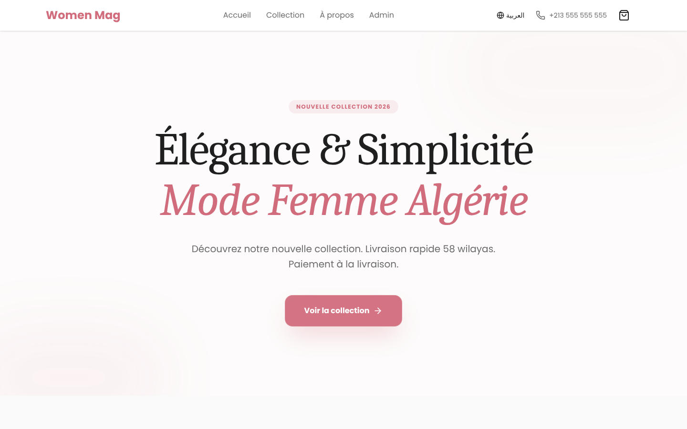

# Women Mag : boutique en ligne (front-end)

Front-end Next.js d'une boutique de mode féminine en Algérie, en français et en arabe : catalogue, panier, commande avec paiement à la livraison, suivi de commande et back-office de gestion des commandes et du stock.


**Démo en ligne :** [womenmag.vercel.app](https://womenmag.vercel.app)



> Projet d'entraînement au développement assisté par l'IA. L'API qui fournit les produits et enregistre les commandes est dans un dépôt privé.

## Fonctionnalités

- **Deux langues** : français et arabe, avec mise en page de droite à gauche pour l'arabe
- **Catalogue** et fiche produit
- **Panier** géré par un contexte React et conservé dans le navigateur (`localStorage`)
- **Commande** avec choix de la wilaya et paiement à la livraison, puis page de confirmation
- **Suivi de commande** par le client
- **Back-office** (`/admin`) : traitement des commandes, inventaire, stock par variante et historique des mouvements de stock

## Stack technique

| Rôle | Outils |
|---|---|
| Framework | Next.js 16 (App Router), React 19, TypeScript |
| Style | Tailwind CSS 4, lucide-react |
| État | Contextes React (panier, langue) |
| Accès à l'API | Réécriture `/api/*` de Next.js vers l'API, pour que les cookies restent sur le même domaine |

## Installation

**Prérequis :** Node.js 18 ou plus, et l'API de la boutique.

```bash
git clone https://github.com/medazero01-art/womenmag.git
cd womenmag
npm install
```

Indiquer l'adresse de l'API dans `.env.local` (par défaut `http://localhost:5000/api`) :

```env
NEXT_PUBLIC_API_URL=http://localhost:5000/api
```

```bash
npm run dev
```

## Structure

```
src/
├── app/
│   ├── products/            # Catalogue et fiche produit
│   ├── cart/, checkout/     # Panier et commande
│   ├── order-confirmation/
│   ├── tracking/            # Suivi de commande
│   └── admin/               # Connexion et tableau de bord
├── components/
├── context/                 # CartContext, LanguageContext
├── locales/                 # fr.ts, ar.ts
└── lib/api.ts               # Appels à l'API
```

## Auteur

**Ayoub Touat** · [@medazero01-art](https://github.com/medazero01-art)
